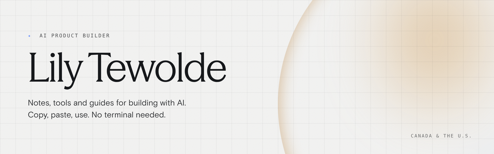

## Hi, I'm Lily

I like to build apps and teach girls AI. I'm a product manager and AI builder.

Everything here comes from things I've built or figured out along the way, including my own job search. You don't need to know how to code to use any of it, since it all works with copy and paste.

### 🧭 Start here

| If you're... | Start with |
|---|---|
| Job hunting | [LinkedIn playbook](https://github.com/Lily-Tewolde/ai-guides/tree/main/02-linkedin-playbook) |
| Getting organized | [Organize your Desktop](https://github.com/Lily-Tewolde/ai-guides/tree/main/01-desktop-organizer) · [Sort a messy image folder](https://github.com/Lily-Tewolde/ai-guides/tree/main/03-image-organizer) |
| Want all my guides | [AI guides](https://github.com/Lily-Tewolde/ai-guides) |

<!-- Hidden until each one is ready:
| Job hunting | add: · [Resume audit](#) |
| Building with Claude | [My Claude workflows and skills](#) |
| Looking for tools | [My awesome list](https://github.com/Lily-Tewolde/awesome-ai-tools) of tools for design, product and engineering |
| Short on time | [Today I learned](https://github.com/Lily-Tewolde/today-i-learned), quick notes |
-->

### 📚 Guides

- [The 5-Step LinkedIn Playbook](https://github.com/Lily-Tewolde/ai-guides/tree/main/02-linkedin-playbook): get found by recruiters, with a Claude prompt for each step
- [How to organize your Desktop with Claude](https://github.com/Lily-Tewolde/ai-guides/tree/main/01-desktop-organizer): 5 to 8 folders and a rulebook that keeps it tidy
- [How to organize a messy image folder with Claude](https://github.com/Lily-Tewolde/ai-guides/tree/main/03-image-organizer): Claude looks at every image, asks how you want them grouped, then sorts

[All guides →](https://github.com/Lily-Tewolde/ai-guides) · [Suggest a guide](https://github.com/Lily-Tewolde/ai-guides/issues/new?template=suggest-a-guide.yml)

<!-- Hidden until today-i-learned has a few notes:
### ✏️ Latest TILs

- 
[All TILs →](https://github.com/Lily-Tewolde/today-i-learned)
-->

### 🧰 Tools I use

My top picks for running product work:

- **Asana:** Love her, she's never let me down. Affordable, easy to use, and ideal for running sprints.
- **Linear:** The more sophisticated older sister of Asana. Really fast and easy to connect to GitHub.
- **PostHog:** The cooler older sibling of Google Analytics. Cute, packed with analytics features, and free to start.

<!-- Add once awesome-ai-tools exists: [Full list →](https://github.com/Lily-Tewolde/awesome-ai-tools) -->

### 💌 Find me

[TikTok @lilytewolde](https://www.tiktok.com/@lilytewolde) · [LinkedIn](https://www.linkedin.com/in/lilytewolde) · [Instagram @promptesss](https://www.instagram.com/promptesss)
